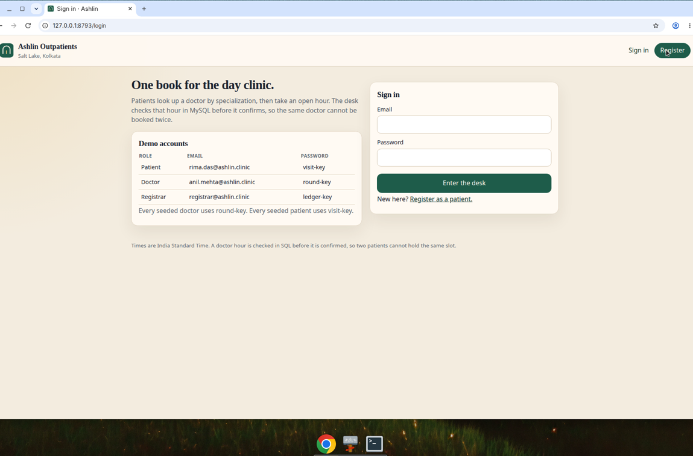
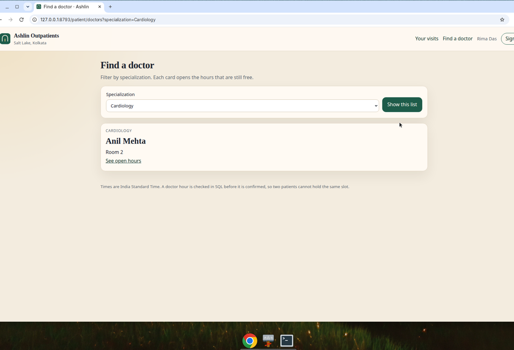
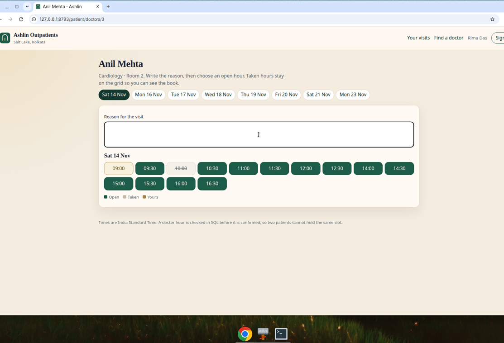
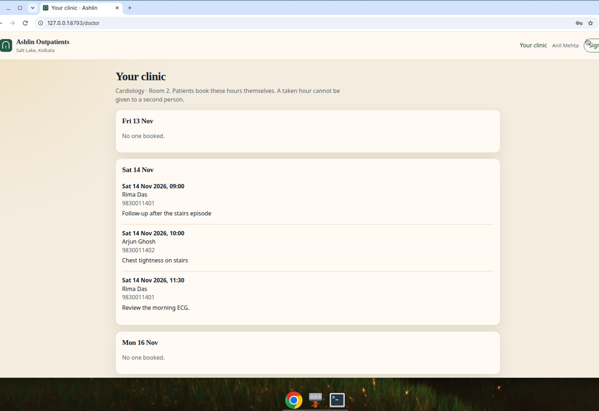
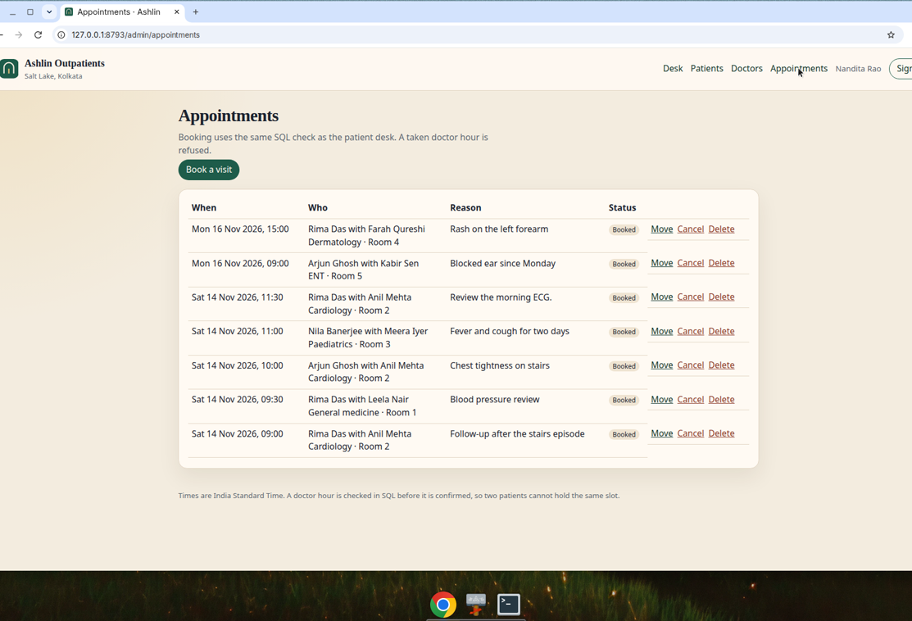

# Ashlin Outpatients

A day-clinic desk for Salt Lake, Kolkata. Patients register and sign in, search doctors by specialization, and book, move, or cancel an hour. Doctors see their own list. The registrar keeps the patient, doctor, and appointment records. Every timestamp is India Standard Time.

A doctor hour is checked in SQL before it is confirmed. The same hour cannot be given to two patients, and one patient cannot hold two doctors at once.



## What you can do

| Role | Sign in | What they do |
| --- | --- | --- |
| Patient | Register, or use a seeded account | Search by specialization, book an open hour, move a future visit, cancel it. |
| Doctor | Seeded accounts | Read the next open days. A taken hour is already someone else’s. |
| Registrar | `registrar@ashlin.clinic` | Create, update, and delete patients, doctors, and appointments. |

The clinic is open Monday to Saturday, 09:00–12:30 and 14:00–16:30, in 30-minute hours. Sunday is closed.









## Stack

Java 21, Spring Boot 4.1.2, Spring MVC, JSP, a servlet filter for the three roles, JDBC (`JdbcTemplate`, DAO classes, no JPA), Bean Validation, HTML, CSS, and a small JavaScript confirm on cancel. The server is embedded Apache Tomcat. MySQL 8 holds the book. Maven builds it.

Layers:

- **Servlet** — `AuthGuardFilter` sends each role to their own pages and leaves `/login`, `/register`, and static files open. Spring MVC’s `DispatcherServlet` handles the rest.
- **Controller** — `AuthController`, `PatientController`, `DoctorController`, `AdminController`.
- **Service** — `AuthService`, `DirectoryService`, `AppointmentService`.
- **DAO** — `PatientDao`, `DoctorDao`, `AdminDao`, `AppointmentDao`, `SpecializationDao`.

## Run it

You need JDK 21, Maven, and MySQL 8 on `localhost:3306`.

```sql
CREATE DATABASE IF NOT EXISTS ashlin
  CHARACTER SET utf8mb4 COLLATE utf8mb4_unicode_ci;
CREATE USER IF NOT EXISTS 'bankuser'@'localhost' IDENTIFIED BY 'meridian_local';
GRANT ALL PRIVILEGES ON ashlin.* TO 'bankuser'@'localhost';
FLUSH PRIVILEGES;
```

```bash
cd ashlin
export DB_USER=bankuser
export DB_PASSWORD=meridian_local
mvn spring-boot:run
```

Those two variables override the defaults in `application.properties`. The JDBC URL is `jdbc:mysql://127.0.0.1:3306/ashlin?serverTimezone=Asia/Kolkata`. The desk listens on port **8793**.

Open `http://127.0.0.1:8793/login`.

On an empty database the app creates the tables from `schema.sql` and seeds six doctors, three patients, the registrar, and a few upcoming visits. Later starts leave existing rows alone. Specializations are inserted if they are missing.

### Seeded passwords

| Who | Email | Password |
| --- | --- | --- |
| Rima Das, Arjun Ghosh, Nila Banerjee | `rima.das@ashlin.clinic`, `arjun.ghosh@ashlin.clinic`, `nila.banerjee@ashlin.clinic` | `visit-key` |
| All six doctors | `anil.mehta@ashlin.clinic` and the others on the same domain | `round-key` |
| Nandita Rao, registrar | `registrar@ashlin.clinic` | `ledger-key` |

Doctors: Leela Nair (general medicine, room 1), Anil Mehta (cardiology, 2), Meera Iyer (paediatrics, 3), Farah Qureshi (dermatology, 4), Kabir Sen (ENT, 5), Joseph D'Souza (orthopaedics, 6).

## Schema

The book is in third normal form. A specialization is its own row. A doctor points at it. An appointment points at one patient and one doctor, and does not copy their names.

```sql
specializations (id, name)
patients        (id, full_name, email, phone, date_of_birth, password_hash, created_at)
doctors         (id, full_name, email, password_hash, specialization_id, room, active)
admins          (id, full_name, email, password_hash)
appointments    (id, patient_id, doctor_id, starts_at, reason, status, created_at)
```

`status` is `BOOKED` or `CANCELLED`. Two stored generated columns are unique while a visit is booked, and become `NULL` when it is cancelled, which frees the hour:

- `active_doctor_slot` — one patient per doctor per hour
- `active_patient_slot` — one doctor per patient per hour

Foreign keys point at `patients`, `doctors`, and `specializations`. Emails are unique inside each role table, and the services also refuse an email that already belongs to another role.

## Double-booking check

`AppointmentService.book` locks the doctor row, then asks the DAO for the count, and only then inserts. `AppointmentDao.countActiveForDoctor` is:

```sql
SELECT COUNT(*)
FROM appointments
WHERE doctor_id = ?
  AND starts_at = ?
  AND status <> 'CANCELLED'
  AND id <> ?
```

A count above zero throws `SlotTakenException` and nothing is written. The same check runs for the patient. Reschedule uses the same queries and ignores the visit being moved. If two requests pass the count together, the unique key rejects the second insert and the service returns the same refusal.

Cancelling sets `status` to `CANCELLED`, which clears the generated keys, so the hour can be booked again.

## Registrar CRUD

- **Patients** — add, edit name, email, phone, date of birth, and password. Delete is refused while any visit still points at them.
- **Doctors** — add, edit, retire. Retiring is refused while future booked visits remain. Delete is refused while any visit still points at them.
- **Appointments** — book on behalf of a patient, move the hour or the reason, cancel, or delete the row. Booking and moving use the same SQL check.

## Tests

```bash
mvn test
```

`ClinicCalendarTest` checks the half-hour grid, the lunch gap, and that a late Friday opens the book on Saturday and skips Sunday.

`AppointmentBookingTest` runs against MySQL. It books one hour, proves a second patient is refused, cancels, and shows the hour can be taken again. It also refuses one patient holding two doctors at the same time, and refuses Sunday.

## Layout

```
ashlin/
  pom.xml
  src/main/java/com/ashlin/clinic/
    web/          controllers, auth filter, JSP form objects
    service/      login, directory, booking rules
    dao/          JDBC
    config/       Tomcat view resolver, clock, seed
    model/
  src/main/webapp/WEB-INF/jsp/
  src/main/resources/schema.sql
  src/test/java/
  docs/screenshots/
```
